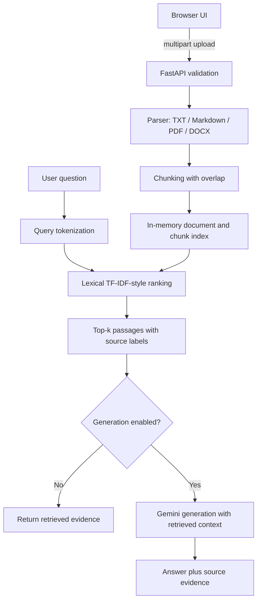

# Architecture and Design Decisions

## Scope

This is a single-process educational document-Q&A prototype. The goal is to make the retrieval path easy to inspect and test before introducing a vector database or persistent multi-user infrastructure.

## Request flow



## Key decisions

### 1. Lexical retrieval before embeddings

**Decision:** use transparent lexical scoring and query-term coverage in the first version.

**Why:** it has few dependencies, runs without a model API key, is deterministic enough for unit tests, and makes ranking behavior inspectable.

**Trade-off:** it may miss semantically related passages that use different wording. It is a baseline, not evidence that lexical search is superior to embeddings.

### 2. In-memory document index

**Decision:** keep uploaded content in process memory for the demo.

**Why:** reduces setup complexity and makes local experimentation easy.

**Trade-off:** documents disappear when the server restarts; this is not suitable for durable workloads or multiple users.

### 3. Optional answer generation

**Decision:** allow retrieval-only mode and make Gemini generation optional.

**Why:** users can test retrieval without provider credentials or API cost.

**Trade-off:** generated text can be incorrect even when relevant passages are supplied. Source labels help verification but do not guarantee faithful citations.

### 4. API validation at the boundary

The upload API enforces supported file formats and a size limit. These checks improve robustness, but they are not a substitute for authentication, malware scanning, tenant isolation, or a production security review.

## Evaluation strategy

Run unit/API tests and the synthetic benchmark:

```bash
python -m unittest tests.test_rag tests.test_rag_api -v
python benchmarks/retrieval_eval.py
```

The benchmark reports Recall@1, Recall@3, and mean reciprocal rank (MRR) over six fixed synthetic queries. This is a smoke test for regressions, not a representative estimate of real-world retrieval quality.

For a meaningful evaluation, build a larger set of realistic questions with human-labelled relevant passages. Keep the dataset separate from code tuning, report confidence and failure cases, and compare the lexical baseline against embedding-based alternatives on the same cases.

## Security and privacy constraints

- Treat uploaded document text as untrusted data.
- Do not upload confidential or regulated documents.
- Never commit API keys.
- There is no authentication or user isolation in this demo.
- Keep the app local until production security controls have been implemented and reviewed.
